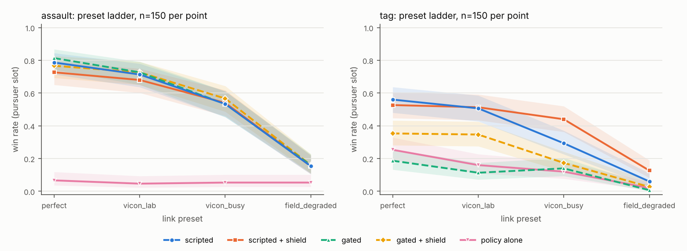
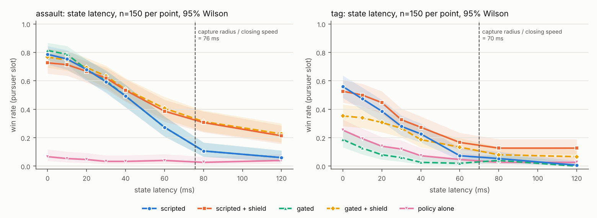
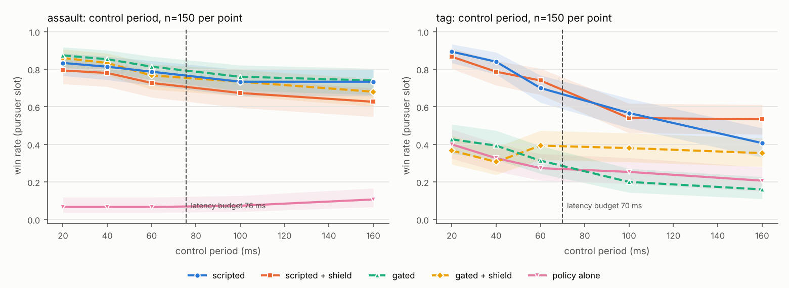

# When does the tree win, when does the policy win, and when does gating win?

**TL;DR.** Across three games — symmetric `tag` and two air-defence problems
(`assault`, `escort`) — a hand-written behaviour tree built on lead-intercept
geometry + explicit target assignment is a **strong, cheap, legible baseline**,
and whether gating a learned policy beats it depends entirely on whether you can
name a regime the baseline does not serve.

- **In `tag` the baseline wins** (~46% capture of random starts) and no learned
  method here beats it; gating tracks and slightly trails it.
- **In air defence the first gate looked like a big win** — `assault` 0.54 →
  0.72 — **but most of that was a bug in the scripted law** (§7.2): it solved
  for a point intercept when a kill needs only the capture sphere. Fixed, the
  scripted law alone reaches 0.77 (`assault`) / 0.49 (`escort`), and a gate
  that hands over on the law's *own* fallback flag adds a smaller, real
  +0.03–0.075 on top (0.80 / 0.53; held-out: 0.845 / 0.62).
- **The gate profile does not transfer, and the failure is expensive.** Porting
  tag's "close quarters is messy, hand it to the policy" instinct to air defence
  costs **42 points** (0.70 → 0.12) — worse than not gating at all. The boundary
  that pays is not *"where is the world messy"* but *"where does the scripted law
  stop being defined"* — read off the law itself, not approximated: gating on
  a geometric proxy of that regime, over the fixed law, *loses* 13 points (§7.2).
- **Run on the *attacker* side of the same game, the identical procedure says
  "don't gate at all"** — every handoff loses breach rate (0.46 → 0.37), so both
  RL branches were deleted from the shipped missile profile. Two opposite
  verdicts from one method is the actual result: the defender's scripted law has
  an undefined regime and the missile's guidance law does not (§7.1).

The learned-side results are a compact tour of when each technique works:

- **RL from scratch (self-play PPO) fails** (0%) — the capture reward is too
  sparse for a random policy to bootstrap in the budget used.
- **Behaviour cloning fails despite near-perfect supervised loss** (MSE 0.003,
  yet ~0% capture) — the textbook covariate-shift failure: it drifts into states
  the expert never showed it and blends between the two evaders instead of
  committing.
- **DAgger fixes exactly that** — relabelling the learner's *own* visited states
  with the expert takes the same network from **0% → 20%** capture standalone,
  and to **42%** — near the scripted 46% — once the gate and safety filter are
  layered on. That is the headline: the *method*, not the budget, was
  the problem.
- **Gating only helps where the policy actually dominates.** In tag the gate
  hands close-quarters/juking/contested ticks to the (now competent) DAgger
  policy, but DAgger still isn't *better* than scripted at the precision endgame,
  so the gate tracks — and slightly trails — pure scripted. Gating a
  merely-competent policy into a strong baseline's home turf doesn't buy wins.
  The defence games are the converse of this, and the reason it's a statement
  about *regimes* rather than about gating.
- **The safety filter is a surprise net-positive.** Enabling the runtime shield on
  the gated controller more than **doubles** its win rate (0.19 → 0.42; 0.46
  with the pre-review position-only fence, which let it overrun the keep-in box
  by up to 0.77 m) by keeping the learned policy inside the geofence/speed
  envelope instead of wandering to the walls — safety here *improves* task
  performance rather than costing it. It is the largest single lever on the
  learned side, which was not the expected result for a V&V layer.
- **Through a realistic link, state latency decides everything** (§8). From
  about 30 ms the defender gate changes no outcome, the shield turns from a
  0.05 cost into the arm worth +0.11 to +0.21, and training the policy under
  the link changes nothing. The recipe for hardware is the scripted law under
  the shield, with the defender gate as a small refinement on a clean volume.
  The earlier "gate survives a well-run Vicon volume (+0.16)" no longer holds.
- **A physical invariant caught a bug that cross-runtime parity could not.** Both
  runtimes agreed exactly on an action-clipping rule that let a diagonal command
  buy 1.73× thrust; it inflated every learned result and was invisible to the
  scripted baseline. Two implementations agreeing proves they agree, not that
  either is right (§4.1).

## 1. Setup

- **Env.** Point-mass agents in a bounded 3D arena (MuJoCo). Drag-limited speed
  (`v_max = gear/damping`); pursuers faster than evaders (5.25 vs 4.75 m/s) —
  without a speed edge, 2v2 capture is impossible. Capture = pursuer within 0.7 m
  of a live evader (it then freezes). Pursuers win iff both evaders are tagged
  within 500 steps (~50 s).
- **Balance.** Tuned so the scripted baseline catches ~40–50% of random starts —
  enough headroom to see a controller beat or miss it, nothing saturated.
- **Controllers compared.**
  - `scripted` — lead-intercept + greedy target assignment (pursuers) / potential-field flee with juking (evaders).
  - `rl_selfplay` — SB3 PPO, alternating self-play against a growing opponent pool.
  - `bc_distill` — an MLP behaviour-cloned from the scripted expert (imitation).
  - `bc_finetuned` — `bc_distill` after PPO fine-tuning on the terminal-intercept sub-task.
  - `dagger` — `bc_distill` repaired with DAgger (expert relabelling of learner states).
  - `bt_gated` — the py_trees / BehaviorTree.CPP gate: policy in close/juking/contested regimes, scripted in clean geometry (routes to the best policy, `dagger`).
  - `bt_gated_safe` — `bt_gated` with the runtime safety filter enabled.

## 2. Methodology (instrumentation)

Every number below comes from the scenario harness (`eval/scenarios.py`): batched
runs over **seeded** random starts, identical seeds across controllers. Two
batteries: **full chase** (open-arena random starts) and **terminal intercept**
(endgame starts, pursuers spawned 3–5 m from an evader, short horizon). Metrics
per episode: **win/capture rate**, **time-to-first-intercept**, **min separation**
(closest approach), **constraint violations** (geofence/speed corrections by the
safety filter), and a **replayable failure log** (spawn state per lost episode →
re-run exactly with `reset_with_starts`). 200 episodes per cell below.

<!-- RESULTS:AUTOFILL -->

**Full chase (random open-arena starts)**

| controller | win rate | mean captures | steps→win | min sep (m) | geo/spd viol |
|---|---|---|---|---|---|
| `scripted` | 0.46 | 1.36 | 75 | 0.73 | 0/0 |
| `rl_selfplay` | 0.00 | 0.00 | — | 5.94 | 0/0 |
| `bc_distill` | 0.01 | 0.02 | 261 | 2.21 | 0/0 |
| `bc_finetuned` | 0.00 | 0.00 | — | 2.81 | 0/0 |
| `dagger` | 0.20 | 1.06 | 154 | 0.74 | 0/0 |
| `bt_gated` | 0.19 | 1.10 | 138 | 0.74 | 0/0 |
| `bt_gated_safe` | 0.46 | 1.36 | 152 | 0.74 | 7005/4296 |

**Terminal intercept (endgame starts)**

| controller | win rate | mean captures | steps→win | min sep (m) | geo/spd viol |
|---|---|---|---|---|---|
| `scripted` | 0.45 | 1.27 | 114 | 0.75 | 0/0 |
| `rl_selfplay` | 0.00 | 0.00 | — | 3.24 | 0/0 |
| `bc_distill` | 0.00 | 0.00 | — | 2.35 | 0/0 |
| `dagger` | 0.20 | 1.11 | 252 | 0.74 | 0/0 |
| `bt_gated` | 0.20 | 1.14 | 206 | 0.74 | 0/0 |

### 2.1 Per-decision instrumentation (the gate explorer)

Aggregate win rates say *whether* a gate helped, never *why*. The batteries above
are therefore paired with a per-tick recorder (`eval/trace.py`) and a
self-contained HTML viewer (`eval/explorer.py`, no server or CDN — the trace is
inlined):

    uv run pe-explore --game assault --seed 3     # -> results/explorer_assault_3.html

For every control step it captures each agent's fired branch, **all** branch
predicates with their live values (not just the winner, so you can see what
nearly fired), what the scripted controller and the policy each wanted at that
instant, the applied command, and whether the safety filter corrected it. It
records the same seed under several controllers so the dropdown is a true A/B on
identical starts, and the URL carries `#trace/step/agent` so a specific moment is
linkable.

Two things fell out of it that the aggregates hid:

- **`pe-explore --game assault --seed 3`** — the defender gate converts a breach
  into a double capture while handing the policy just **3 of 62 agent-ticks**,
  all in the terminal seconds. The gate's value is concentrated in a handful of
  decisions rather than spread across the episode, which is what §7's
  "structurally undefined regime" argument predicts and what a win-rate column
  cannot show.
- **`pe-explore --game tag --seed 13`** — an episode the safety filter *loses*
  (see §4), despite being strongly net-positive in aggregate.

(Both are regenerated on demand; `results/` is not committed.)

The branch metadata the viewer renders is generated from the predicate table
itself rather than re-implemented in JavaScript, and a test
(`test_branch_reads_match_predicates`) fails if a predicate is added without it,
so the explanation cannot drift from the tree that actually ran.

## 3. When each wins

- **Open chase & precision endgame → scripted.** Lead-intercept with explicit
  assignment is near-optimal when the bearing is clean, and it *commits* to a
  target, so it closes the final metre. It is the best single controller in both
  batteries (0.46 / 0.45). This is the regime where a hand-written tree is simply
  the right tool.
- **RL-from-scratch → nowhere (here).** With a capture-sparse reward and a modest
  self-play budget, PPO never sees enough reward to bootstrap and lands at 0%. Not
  a bug — a sample-efficiency reality. (Note the *same* PPO machinery works once
  warm-started, below, which rules out an implementation fault.)
- **Behaviour cloning → deceptively broken.** `bc_distill` reaches MSE 0.003 —
  it has "learned" the expert in the supervised sense — but captures ~0% and
  stalls ~2 m out. Two compounding effects: (a) covariate shift (it visits states
  the open-loop expert data never covered) and (b) it regresses toward the mean of
  a *bimodal* target (two evaders) and steers to the midpoint instead of
  committing. Low loss ≠ good closed-loop control.
- **DAgger → the learned-side win.** Feeding the learner its own visited states
  with expert labels (and the expert always commits to an assignment) drives it
  from **0% → 20%** standalone (1.06 mean captures; 0.21 on the endgame battery).
  This is *when imitation works*: on-policy relabelling, not more offline data.
  It is still well short of scripted's 0.46.
- **Gating → only as good as the policy you gate.** `bt_gated` routes the messy
  regimes to `dagger`, but `dagger` is competent, not superior to scripted in
  those regimes, so the gate lands at 0.19 — indistinguishable from the policy it
  gates (0.20), and far below pure scripted. The honest lesson: a gate is worth it
  precisely when the learned policy *dominates* some slice; identifying (or
  training) such a slice is the prerequisite, and a strong scripted baseline
  raises that bar. §7 is what happens when you find such a slice; §7.1 is what
  happens when you go looking and it is not there.
- **Safety filter → the biggest single lever on the learned side.**
  `bt_gated_safe` scores **0.46** against `bt_gated`'s 0.19: it more than doubles
  the gated controller and pulls level with the scripted baseline (0.455, and the
  same 1.365 mean captures). The DAgger policy habitually drives toward the arena
  walls; the shield fires constantly (7005 geofence + 4296 speed corrections over
  200 episodes) and redirects it into productive space. A layer added for V&V
  turns out to be the most effective *performance* component in the learned
  stack — see §4.

## 4. Safety / V&V

The safety filter is a runtime shield *below* the BT and the policy: an operational
geofence (keep-in box inside the arena) and a speed cap, either of which can
override the commanded action. It is a pure function, mirrored in Python and C++,
and unit-tested on both sides; every BT node has a unit test (`cpp/tests`,
`tests/test_env.py`). Unlike the usual "safety costs a little performance" story,
here it *helped*: on the gated DAgger controller it fired constantly (11970
geofence + 4924 speed corrections over 200 episodes with the brake-aware fence)
and took the win rate from 0.19 to 0.42 by keeping the policy in-bounds. (The
original position-only fence scored 0.46 but let the pursuers overrun the
keep-in box by up to 0.77 m and touch the arena wall in 11/200 episodes; the
current fence acts on predicted position and holds the overrun to 0.23 m with
no wall contacts — a non-significant −0.035 for a real safety margin.) That is a strong argument for a
*separable* safety layer — it both guarantees the constraints and, as a bonus,
clips a learned policy's out-of-distribution excursions, without touching the
reward.

Two caveats keep this honest. The shield's contribution is **game-specific**: in
air defence it does little (`assault` 0.80 → 0.81) and in `escort` it now
costs 0.06 (0.53 → 0.47, unpaired — the fence change itself measured neutral
there, so the speed cap is the suspect), because the defender gate's scripted
branch rarely goes near the geofence in the first place. And it is not uniformly positive even in
tag — `pe-explore --game tag --seed 13` records an episode where the gated
controller captures both evaders in 48 steps *without* the shield and times out
*with* it, the geofence having deflected a converging intercept. It wins on
average and loses individual episodes; a per-episode trace is the only way to see
that, which is what §2.1 is for.

### 4.1 The bug the V&V suite could not see

Adding the two defence games meant factoring the airframe map out of the core, and
that refactor changed one line for `tag` as well: commands are now clipped by
**norm** rather than per component. The three actuators each take `[-1, 1]`, so
under the old rule a drone commanded `(1, 1, 1)` pulled `√3 · gear` and reached a
measured **7.42 m/s** against a documented `v_max = gear/damping = 5.25`. Thrust
was anisotropic; the speed limit was only true along the axes.

What makes this worth writing down is *how well it hid*. The scripted controllers
emit unit-norm direction vectors, so they never touched the corner of the action
cube: the tag baseline, `arena.xml`, the exact-start checksums and the
Python↔C++ parity results were **bit-identical under both rules**. Every check in
§5 passed, before and after — because both runtimes had the same clip. Parity
demonstrates that two implementations agree, not that either is right.

A learned policy, of course, fills the action cube, and PPO will happily find 73%
of free thrust. So the entire cost of the bug landed on exactly the numbers this
writeup is about. The then-shipped DAgger checkpoint — selected on a 40-episode
battery during training — scores **0.28 on that battery under the old rule and
0.125 under the fixed one**. Roughly half of an earlier draft's headline number
was the exploit, not the method.

The policy was then retrained from scratch under the corrected dynamics, and the
refit recovers most of the loss honestly: **0.20** on the independent 200-episode
battery, against the old checkpoint's 0.14 there. That refit is what every table
in this document now uses. It also produced a clean demonstration of the
selection bias described in §8 — it scored 0.30 on its own 40-episode selection
battery and 0.20 on the held-out 200.

The fix is kept: isotropic thrust is the correct physics and it makes the speed
bound the rest of the document quotes actually true. All tables above were
regenerated under it. What caught it was not a cross-check but a **physical
invariant** — measure the achievable top speed and compare it to the bound you
claim — and that is now a unit test in both runtimes
(`test_drone_thrust_is_isotropic`). The general lesson for a V&V suite: mirror
tests catch divergence, property tests catch shared mistakes, and you need both.

## 5. Two runtimes, cross-validated

The research stack is Python (MuJoCo + SB3 + py_trees); the **production runtime is
C++** (MuJoCo C API + **BehaviorTree.CPP** with a Groot2-editable tree + policy via
**ONNX Runtime** + the safety filter). Both load the same `arena.xml` and link the
same `libmujoco`. Parity is enforced two ways:

- **Exact-start checksums** (`pe_run --parity` vs the Python rollout) match to
  ~1e-6 — identical dynamics and scripted logic. On a shared 100-episode start
  set, C++ scripted and Python scripted score identically (0.48 / 0.48).
- **The neural policy and the gate match exactly too.** Both runtimes run the
  same ONNX file through the same ONNX Runtime version, and on a shared
  200-episode tag start set the full gated + shielded stack scores identically
  in C++ and Python (win 0.45, geofence/speed interventions 6974/4397 — every
  counter equal). Exact-start parity holds for every game × {scripted,
  bt_safe} and runs in CI.

  This section used to say the opposite: that the gated tag controller drifted
  (0.13 C++ vs 0.18 Python) because "discrete gate decisions amplify ~1e-6
  policy differences over 500 chaotic steps" — and that this was the honest
  limit of cross-runtime validation. It was a bug. The C++ side computed
  `v * (1.0 / n)` wherever numpy computes `v / n`; the two differ by one ulp in
  a fraction of cases, and a per-tick action dump located the first divergence
  at tick 12 of a gated chase. Scripted-only parity never exposed it because
  the scripted law happened not to hit a differing case on the fixed starts.
  Lesson, in the same vein as §4.1: a plausible physical story ("chaos") for a
  residual is not evidence; bisect it to the first differing number.

## 6. Different games, different winners

Tag has one weakness as evidence: it is a single problem, so "the gate trails
scripted" could just be a fact about *this* chase rather than about gating. So
the env grew two more games that reuse the same slots, controllers, observation
encoding, gate machinery, safety filter and metrics — only the **objective**,
the **airframes** and the **spawn geometry** change:

| game | pursuer slot | evader slot | objective | timeout favours |
|---|---|---|---|---|
| `tag` | drone pursuers (5.25 m/s) | drone evaders (4.75 m/s) | tag both evaders | evaders |
| `assault` | interceptor drones (7.5 m/s) | **missiles** (11 m/s) | stop the raid on a static asset | **defenders** |
| `escort` | interceptor drones (7.5 m/s) | **missiles**, long burn | protect a convoy in transit | **defenders** |

Two things flip at once, and both matter:

- **The speed edge inverts.** In tag the pursuer is *faster*, so a tail chase is
  a valid plan. In the defence games the attacker is ~47% faster, so a defender
  can never convert to a stern chase — it must solve a *crossing* intercept or
  lose. That single change makes the terminal problem geometric rather than
  reactive.
- **Attackers are missiles, not drones.** Heterogeneous dynamics are a pure
  command transform (`dynamics.py:apply_dynamics`), not a new physics path: a
  holonomic drone gets its command verbatim, while a missile keeps thrust on its
  velocity axis, can only spend `lat_authority` (0.45) of its command laterally,
  carries a finite burn, and is out of the fight once it coasts below stall.
  Turn radius therefore grows as `v²/a_lat` — a fast missile is committed, which
  is exactly the property the gate exploits.

<!-- GAMES:AUTOFILL -->

**tag** — pursuers (pursuer slot) vs evaders; win = both tagged

| controller | win rate | mean captures | steps→win | min sep (m) | geo/spd viol |
|---|---|---|---|---|---|
| `scripted` | 0.46 | 1.36 | 75 | 0.73 | 0/0 |
| `pursuer` | 0.00 | 0.00 | — | 5.94 | 0/0 |
| `pursuer_bc` | 0.01 | 0.02 | 261 | 2.21 | 0/0 |
| `pursuer_bc_ft` | 0.00 | 0.00 | — | 2.81 | 0/0 |
| `pursuer_dagger` | 0.20 | 1.06 | 154 | 0.74 | 0/0 |
| `bt_gated` | 0.19 | 1.10 | 138 | 0.74 | 0/0 |
| `bt_gated_safe` | 0.42 | 1.38 | 202 | 0.73 | 11970/4924 |

**assault** — defenders (pursuer slot) vs attackers; win = raid stopped

| controller | defended | breach rate | attackers down | burned out | closest approach (m) | geo/spd viol |
|---|---|---|---|---|---|---|
| `scripted` | 0.77 | 0.23 | 1.72 | 0.01 | 11.28 | 0/0 |
| `assault_dagger` | 0.04 | 0.96 | 0.26 | 0.01 | 2.44 | 0/0 |
| `bt_gated` | 0.80 | 0.20 | 1.74 | 0.00 | 11.53 | 0/0 |
| `bt_gated_safe` | 0.81 | 0.18 | 1.74 | 0.00 | 11.50 | 8/546 |

**escort** — escorts (pursuer slot) vs attackers; win = raid stopped

| controller | defended | breach rate | attackers down | burned out | closest approach (m) | geo/spd viol |
|---|---|---|---|---|---|---|
| `scripted` | 0.49 | 0.51 | 1.24 | 0.00 | 3.85 | 0/0 |
| `escort_dagger` | 0.25 | 0.75 | 0.70 | 0.00 | 2.26 | 0/0 |
| `bt_gated` | 0.53 | 0.47 | 1.31 | 0.00 | 4.20 | 0/0 |
| `bt_gated_safe` | 0.47 | 0.54 | 1.26 | 0.00 | 3.38 | 555/345 |

## 7. The air-defence gate is a *different* tree — and that is the result

The tag gate says: *close quarters is messy, hand it to the policy.* Porting that
instinct to air defence and measuring it is the most useful thing in this repo,
because **the instinct is wrong, and expensively so**. Gating on one predicate
at a time (`assault`, 150 episodes × 2 independent seed blocks, DAgger policy on
the RL branch, defender win rate):

| gate profile | seed block A | seed block B |
|---|---|---|
| scripted only | 0.54 | 0.56 |
| **`intercept_infeasible` → RL** | **0.70** | **0.71** |
| + `threat_imminent` → RL | 0.45 | 0.45 |
| + `close_quarters` → RL | 0.12 | 0.12 |
| RL only | 0.03 | 0.03 |

Handing close quarters to the policy costs **42 points** (0.70 → 0.12) — worse
than not gating at all, and nearly as bad as deleting the scripted controller.
The reason is that the terminal endgame against a missile is *not* a scrappy
dogfight. It is a precise geometry problem, and the lead-intercept law solves it
near-optimally while the policy cannot.

The regime actually worth handing over is the one where the scripted law is not
merely imprecise but **structurally undefined**: when the target is faster and
opening, `lead_intercept_time` has no positive root, so no constant-speed pursuit
closes it. The scripted controller's fallback is to park on a static gate point —
it has nothing better to offer, and *anything* is an improvement. So the shipped
profile (`bt/gating.py:_defender_predicates`, `cpp/trees/gate_defenders.xml`) is
two branches, not four.

This is the sharpest version of the project's thesis. The right gate boundary is
**not** "where is the world messy" but **"where does the scripted controller stop
being defined"** — and that is a property you can read off the controller's own
math rather than tune by intuition. Two consequences worth noting:

- **The same tree adapts across games without retuning.** On `assault` it routes
  15% of ticks to the policy; on `escort` it routes 59% — a moving asset makes
  intercept solutions infeasible far more often. The predicate is about the
  scripted law's validity, not a threshold fitted to one game.
- **The gate now wins outright**, which it never did in tag. On the 200-episode
  battery in §6 (pre-review): `assault` scripted 0.54 → gated **0.72**, with the safety filter
  costing nothing (0.72 → 0.72); `escort` scripted 0.40 → gated **0.46** (0.44
  shielded). The ablation above ran 150 episodes on two independent seed blocks
  and put the same profile at 0.70/0.71 — consistent, and a useful reminder of
  how wide the ±1σ band is at this sample size. The tag conclusion
  ("gating a merely-competent policy into a strong baseline's home turf doesn't
  buy wins") was right, and the defence games show its converse: find a regime
  the baseline genuinely cannot serve, and gating pays immediately.

### 7.1 The attacker gate: the same experiment, the opposite answer

The defender result above could be a story about *air defence*. To find out, the
identical procedure was run on the other side of the same game: train an attacker
policy by DAgger against the scripted raid doctrine
(`assault_attacker_dagger`, breach 0.33/0.35), then ablate the missile gate one
predicate at a time. Scored as **breach rate**, so higher is better for the
attacker:

| gate profile | seed block A | seed block B |
|---|---|---|
| **scripted only** | **0.46** | **0.57** |
| + `committed` → SCRIPTED | 0.46 | 0.57 |
| + `threat_close` → RL | 0.41 | 0.49 |
| + `threat_closing_fast` → RL | 0.37 | 0.38 |
| policy only | 0.33 | 0.35 |

Monotonically downhill. **Every handoff costs breach rate**; the best attacker
gate is no gate at all. So both RL branches were deleted from
`_attacker_predicates` and `cpp/trees/gate_attackers.xml`, which now route
everything to the scripted law — the surviving `committed` branch is a
no-op kept only because it states the run-in regime legibly in Groot2.

That is a more useful outcome than a second win would have been, because it
falsifies the cheap reading of §7. The defender gains 16 points from exactly one
handoff; the attacker gains nothing from any. Same game, same machinery, same
sample sizes, opposite verdicts — so the earlier result is not "gating works in
air defence". The difference is structural:

> The defender's scripted law has a regime where it is **undefined** — no positive
> lead-intercept root, so it parks on a static gate point and has nothing to
> offer. The missile's guidance law has no such regime. A committed terminal
> run-in is precisely the case a lead-guidance law is *for*, and the policy
> is strictly worse everywhere.

**Hand a regime to the policy where the scripted controller is undefined, not
merely where it is imprecise, and not where the situation merely feels messy.**
That predicate is readable off the controller's own math, which is why it
transfers between `assault` and `escort` without retuning and why the two
intuition-driven profiles (tag's four branches, the missile's three) both lost.
It is also a cheap test to apply before writing a gate at all: if the scripted
law is well-defined everywhere in the state space, a gate is unlikely to pay,
and the honest recommendation is to skip it — as it is here.

Both the removal and the reasoning are pinned by tests in both runtimes
(`test_attacker_gate_hands_over_nothing`, and its doctest mirror ticking the
shipped XML), so the profile cannot silently regrow the branches that lost.

### 7.2 Revisited: the regime was partly a bug in the scripted law

A later review asked two questions of §7 that its ablation could not, and both
answers changed the shipped code.

**Was the predicate the law's regime?** No — an approximation of it.
`intercept_infeasible` asked whether a *point* intercept of the *nearest*
threat exists. The scripted law actually switches on its *assigned* threat
(ordered by time-to-asset) and also falls back when the intercept would land
after the missile reaches the asset. Over 13,148 agent-ticks of the shipped
gate, 14% of handovers happened while the law still had an intercept, and the
law was parked on its gate point on 957 ticks (37% of its fallback) that the
gate left with it.

**Was the regime genuinely undefined?** Mostly not. A kill only needs the gap
under the 1.4 m capture radius, but the law solved for the point. Solving
|rel + v·t| = v_p·t + r instead — about fifteen lines — shrinks the "no
solution" band dramatically. A 3×3 matrix (law: r ∈ {0, 0.7, 1.4} m × gate:
none / old proxy / the law's own fallback flag) on seed blocks 10000 and
110000 picked r = 0.7 m; then on held-out seeds 20000+ (n = 200, paired):

| defender stack | `assault` | `escort` |
|---|---|---|
| point-solve law (§7's baseline) | 0.525 | 0.440 |
| point-solve law + `intercept_infeasible` gate (§7, was shipped) | 0.730 | 0.495 |
| sphere-solve law, no gate | 0.795 | 0.545 |
| sphere-solve law + gate on the law's own fallback flag (**shipped**) | **0.845** | **0.620** |

Three consequences:

- **Most of §7's +0.17 was a fix the scripted law could make itself.** The
  corrected law alone beats the old gated stack in `assault`. What the policy
  added was largely covering for a solver that called reachable geometry
  "impossible" — and that policy is itself a DAgger clone of the old law, so in
  the fallback regime it was a smoothed copy of the very behaviour the gate was
  bypassing.
- **The thesis survives, smaller and sharper.** Over the corrected law, gating
  on the law's *own* fallback flag still earns +0.05 (`assault`) and +0.075
  (`escort`), both intervals excluding zero. Gating on the old *proxy* over the
  same corrected law loses 13 points (`assault`) and 8 (`escort`): it hands the
  policy geometry the law now handles. "Hand over where the scripted law is
  undefined" holds — but it must be read off the law (`GuardDefenders.plan()`
  returns the flag the gate consumes), not off an approximation of it.
- **The first question to ask of an "undefined" regime is whether the scripted
  law is solving the right problem.** A gate can paper over a solver bug and
  measure as a win. The method in §7 — ablate one predicate at a time — cannot
  tell those apart; changing the scripted law can.

### 7.3 Gate value against policy quality

The policy on the defender gate's RL branch was a DAgger clone of the
point-solve law (§7.2). It was retrained against the sphere-solve law with
every iteration kept (`train/dagger.py`, 9 iterations of 100 episodes,
selection battery seeds 9000-9039), and each checkpoint was measured alone and
behind the shipped gate on two held-out blocks of 200 episodes (A: seeds
20000+, B: 110000+), paired against the scripted law. The prediction from
ROADMAP #4 was that gated minus scripted would stay flat while the policy's
own win rate rose (`scripts/analysis/gate_vs_policy.py`).

`assault` (scripted 0.795 on A, 0.740 on B):

| checkpoint | policy alone, A / B | gated - scripted, A | gated - scripted, B |
|---|---|---|---|
| it0 (BC) | 0.005 / 0.010 | +0.065 [+0.035, +0.100] | +0.035 [+0.010, +0.060] |
| it2 | 0.055 / 0.045 | +0.045 [+0.010, +0.080] | +0.035 [+0.010, +0.065] |
| it4 | 0.120 / 0.130 | +0.055 [+0.020, +0.095] | +0.055 [+0.025, +0.090] |
| it6 | 0.115 / 0.140 | +0.025 [-0.005, +0.060] | +0.045 [+0.020, +0.075] |
| it8 (best on selection) | 0.175 / 0.170 | +0.025 [-0.005, +0.055] | +0.040 [+0.015, +0.070] |
| shipped (old-law clone) | 0.065 / 0.090 | +0.050 [+0.020, +0.085] | +0.075 [+0.040, +0.115] |

`escort` (scripted 0.545 on both blocks):

| checkpoint | policy alone, A / B | gated - scripted, A | gated - scripted, B |
|---|---|---|---|
| it0 (BC) | 0.120 / 0.105 | +0.245 [+0.175, +0.315] | +0.270 [+0.205, +0.335] |
| it2 | 0.165 / 0.125 | +0.050 [-0.025, +0.130] | +0.015 [-0.050, +0.080] |
| it5 | 0.400 / 0.320 | +0.085 [+0.025, +0.150] | +0.055 [+0.010, +0.100] |
| it7 (best on selection) | 0.345 / 0.325 | +0.070 [+0.005, +0.140] | +0.025 [-0.020, +0.070] |
| it8 | 0.280 / 0.315 | +0.070 [+0.010, +0.130] | +0.010 [-0.040, +0.060] |
| shipped (old-law clone) | 0.290 / 0.280 | +0.075 [+0.015, +0.135] | +0.035 [-0.015, +0.085] |

(Odd iterations omitted; the full tables are in the script's JSON output.)
The least-squares slope of gated minus scripted on policy-alone win rate,
across the nine iterations with an episode bootstrap, is -0.19 [-0.41, -0.01]
(assault, A), +0.01 [-0.16, +0.20] (assault, B), -0.06 [-0.24, +0.11]
(escort, A) and -0.17 [-0.38, +0.03] (escort, B).

The first half of the prediction held: in neither game does the gate's gain
rise with the policy's own quality. In `assault` the policy alone went from
0.005 to 0.175 while the gain stayed between +0.025 and +0.075. The second
half held for `assault` only. In `escort` one checkpoint stands far out: the
iteration-0 behaviour clone, trained only on states the scripted law visited,
adds +0.245 and +0.270 on the two blocks while flying alone at 0.12. Every
later iteration adds +0.01 to +0.09.

So the policy's win rate on its own is the wrong axis. What decides the gain
is what the policy does inside the regime it is handed. To check that, the RL
branch was replaced by simple scripted rules for the same regime
(`scripts/analysis/fallback_probe.py`, block A unless noted):

| what fills the law's fallback regime | `assault` | `escort` |
|---|---|---|
| nothing (scripted law parks on its gate point) | 0.795 | 0.545 |
| hold still | -0.010 [-0.040, +0.020] | -0.210 [-0.275, -0.145] |
| pure pursuit of the nearest attacker | +0.060 [+0.030, +0.095] | -0.215 [-0.285, -0.150] |
| the law's gate point placed on the asset's predicted position | same as the law (static asset) | +0.095 [+0.025, +0.165]; B: +0.075 [+0.020, +0.130] |
| best DAgger policy | +0.065 (it0) | +0.245 (it0) |

In `assault`, one line of pure pursuit recovers everything any policy adds.
The residual +0.05 after §7.2 is therefore a second fix the scripted law
could make itself: when no intercept exists, chase rather than park. In
`escort` the convoy moves, so chasing abandons it and parking guards a point
the convoy has already left. Putting the gate point on the convoy's predicted
position recovers +0.075 to +0.095. Over 60 episodes of block A, in
the fallback ticks, the iteration-0 policy's command has mean cosine 0.77
with the convoy's direction of travel (0.72 for the best-on-selection
checkpoint) and 0.64 with the law's own fallback command (0.89). It appears to have
learned the same correction, and more of it, from the expert's average
behaviour. Later DAgger iterations relabel the learner's own states with the
law's fallback action and train that behaviour back out.

The lesson from §7.2 applies again. Before attributing a gate's gain to the
learned branch, try simple scripted fills of the same regime. Two of the three
gains measured here are rules the scripted law can adopt. The escort it0 gain is
the only one no simple rule matched, and it is larger than anything else in
the defence games.

### Cross-runtime validation of the new games

Both defence games were re-validated under the CLAUDE.md invariant. On a shared
100-episode start set (`--starts-file`), Python and C++ agree **exactly** on
every metric — including the ONNX policy path, the BehaviorTree.CPP gate, and the
safety filter's individual violation counts:

| assault, shared starts | win | captures | breach | asset margin | geo/spd viol |
|---|---|---|---|---|---|
| `scripted` (py = cpp) | 0.54 | 1.40 | 0.46 | 8.3 | 0/0 |
| `rl` (py = cpp) | 0.05 | 0.25 | 0.95 | 2.4 | 0/0 |
| `bt_gated` (py = cpp) | 0.68 | 1.56 | 0.32 | 9.7 | 0/0 |
| `bt_gated_safe` (py = cpp) | 0.70 | 1.62 | 0.30 | 9.7 | 19/238 |

(Pre-review numbers; the defender law and gate changed in §7.2. Parity for the
current stack is exact and checked in CI — and tag now matches exactly too, §5.)

**One honest V&V caveat.** The geofence can only *request* a correction from a
missile. The safety filter emits a desired command, but the airframe transform
runs after it, and a missile with 0.45 lateral authority cannot comply with an
arbitrary correction. Missiles stay hard-bounded by their MuJoCo joint ranges —
so the invariant is enforced, but by the *model*, not by the shield. On a real
vehicle that distinction matters: a shield you cannot actuate is not a shield.

## 8. Robustness to the link

Every number above was measured through a perfect link: controllers saw exact
state and their commands acted at once. This section re-measures the shipped
stacks through a modelled sim-to-real link (`env/link.py`, mirrored in the C++
runtime with exact parity) to find which stack to fly on 2-4 real airframes.

**Protocol.** One axis at a time from nominal upward (state latency, uplink
latency, motor lag, velocity and position noise, identity swaps, marker
occlusion, packet loss, battery sag), plus a ladder of four whole-rig presets
(`perfect`, `vicon_lab`, `vicon_busy`, `field_degraded`) and the control
period itself (`pe-robust`). n = 150 episodes per point on seeds 20000+.
Every arm at a level sees the same spawns and the same corruption
realisation, so differences between arms are paired: win rates carry 95%
Wilson intervals, deltas carry 95% paired-bootstrap intervals, and an
asterisk marks an interval that excludes zero. These tables use a different
seed block from the headline tables in §6 (10000+) and are not comparable
with them cell for cell. All numbers are on the post-2026-09-30 semantics
(sphere-solve defender law, gate on the law's own fallback flag,
brake-aware fence). Arms: the scripted law, the scripted law under the
shield, the gate, the gate under the shield, and the policy alone.

Two limits apply to the whole section. **The opponent always flies a perfect
link**: only the pursuer-slot stack is degraded, so these curves measure one
team's sensitivity, not a symmetric degradation (REVIEW #7). **There is no
multiple-comparison correction**: the full sweep has roughly 300 paired
deltas, and at the 95% level about 15 of them would exclude zero by chance.
Single starred cells are weak evidence; patterns across adjacent levels and
across both games are what the conclusions rest on.

Figures: `figures/robust_latency.png`, `figures/robust_presets.png`,
`figures/robust_control_rate.png`. Tables: `scripts/analysis/robust_report.py`
on the `pe-robust` JSONs.

### 8.1 The preset ladder

| `assault` | scripted | scripted + shield | gate | gate + shield | policy alone |
|---|---|---|---|---|---|
| perfect | 0.787 | 0.727 | 0.813 | 0.767 | 0.067 |
| vicon_lab | 0.713 | 0.680 | 0.727 | 0.727 | 0.047 |
| vicon_busy | 0.533 | 0.540 | 0.533 | 0.567 | 0.053 |
| field_degraded | 0.153 | 0.153 | 0.160 | 0.160 | 0.053 |

| `tag` | scripted | scripted + shield | gate | gate + shield | policy alone |
|---|---|---|---|---|---|
| perfect | 0.560 | 0.527 | 0.187 | 0.353 | 0.253 |
| vicon_lab | 0.507 | 0.513 | 0.113 | 0.347 | 0.160 |
| vicon_busy | 0.293 | 0.440 | 0.140 | 0.173 | 0.120 |
| field_degraded | 0.060 | 0.127 | 0.007 | 0.027 | 0.020 |

Paired deltas:

| preset | `assault` gate - scripted | `assault` gate + shield - scripted + shield | `assault` shield on scripted | `tag` shield on scripted | `tag` shield on gate |
|---|---|---|---|---|---|
| perfect | +0.027 [+0.000, +0.060] | +0.040 [+0.013, +0.073]* | -0.060 [-0.107, -0.013]* | -0.033 [-0.120, +0.053] | +0.167 [+0.067, +0.267]* |
| vicon_lab | +0.013 [-0.013, +0.040] | +0.047 [+0.013, +0.080]* | -0.033 [-0.073, +0.000] | +0.007 [-0.087, +0.100] | +0.233 [+0.140, +0.327]* |
| vicon_busy | +0.000 [-0.027, +0.027] | +0.027 [+0.000, +0.060] | +0.007 [-0.033, +0.053] | +0.147 [+0.053, +0.240]* | +0.033 [-0.047, +0.113] |
| field_degraded | +0.007 [+0.000, +0.020] | +0.007 [+0.000, +0.020] | +0.000 | +0.067 [+0.000, +0.133] | +0.020 [-0.007, +0.053] |

**The old headline does not hold.** Before the 2026-09-30 review, the gate's
advantage in `assault` was +0.23 at a perfect link and +0.16 on `vicon_lab`,
and was reported as "the gate survives a well-run Vicon volume". That
advantage was mostly the old law's point-solve bug (§7.2) surviving the link.
Over the corrected law, the unshielded gate adds +0.027 at a perfect link and
+0.013 (not significant) on `vicon_lab`. Under the shield the gate still adds
+0.040 and +0.047, both significant, so on a clean volume it remains a small
refinement on top of the shield. In `tag` the gate loses at every rung, with
or without the shield.

### 8.2 The latency cliff and `latency_budget`

State latency is the axis that decides the outcome. `assault` scripted falls
0.787, 0.680, 0.493, 0.273, 0.107 at 0, 20, 40, 60, 80 ms; `tag` scripted
falls 0.560, 0.387, 0.227, 0.073, 0.053 at the same points. In `assault`, 40 ms
of latency (-0.29) costs about as much as the worst level of position noise
(0.40 m, -0.29), and only heavy occlusion (20% of ticks in 5-tick bursts,
-0.57) and 80 ms of motor lag (-0.42) cost more, at levels far beyond a
working mocap rig (§8.5).

`latency_budget(game) = capture_radius / closing_speed` is the lag at which
the estimate of the opponent has moved by the whole capture tolerance: 76 ms
for `assault` (1.4 m / 18.5 m/s) and 70 ms for `tag` (0.7 m / 10 m/s). It
predicts where the curves reach their floor, without simulation: by 80 ms
`assault` scripted is at 0.107 and `tag` at 0.053. The budget is not a hard
wall; scripted `assault` still wins 0.06 at 120 ms, and the shielded arms
level off near 0.2-0.3, so "no controller of any kind can intercept" past it
overstates the case. Constant-velocity forward prediction of the delayed
estimate recovers only +0.01 (20 ms) to +0.12 (40 ms) (2026-09-30 review), so
the cliff is not an artefact of naive delay handling. The fixed scripted law
degrades more gracefully than the old one did (40 ms: 0.49 vs 0.19; 60 ms:
0.27 vs 0.05).

### 8.3 The shield goes from a cost to the load-bearing arm

| state latency | `assault` shield on scripted | `assault` shield on gate | `tag` shield on scripted | `tag` shield on gate |
|---|---|---|---|---|
| 0 ms | -0.060 [-0.107, -0.013]* | -0.047 [-0.093, -0.007]* | -0.033 [-0.120, +0.053] | +0.167 [+0.067, +0.267]* |
| 20 ms | -0.013 [-0.067, +0.040] | +0.013 [-0.033, +0.060] | +0.060 [-0.033, +0.153] | +0.227 [+0.140, +0.313]* |
| 40 ms | +0.040 [+0.000, +0.087] | +0.047 [+0.007, +0.093]* | +0.047 [-0.047, +0.133] | +0.160 [+0.093, +0.233]* |
| 60 ms | +0.113 [+0.053, +0.180]* | +0.133 [+0.067, +0.200]* | +0.093 [+0.027, +0.160]* | +0.113 [+0.053, +0.173]* |
| 80 ms | +0.200 [+0.133, +0.267]* | +0.207 [+0.140, +0.280]* | +0.073 [+0.013, +0.133]* | +0.040 [-0.013, +0.093] |
| 120 ms | +0.153 [+0.100, +0.213]* | +0.167 [+0.113, +0.227]* | +0.120 [+0.073, +0.173]* | +0.067 [+0.027, +0.107]* |

At a perfect link the shield costs `assault` 0.05-0.06: its speed cap
removes the accelerating component whenever a defender is above 0.98 of top
speed, which a crossing intercept needs (the same cap carries most of the
shield's cost in `escort`; REVIEW). The cost crosses zero between 20 and
30 ms. From 60 ms the shield is worth +0.11 to +0.21 in `assault` and +0.07
to +0.12 on the `tag` scripted law: on a stale estimate the fence and the cap
stop the aircraft from committing to an intercept that no longer exists and
keep it in the volume where the next estimate can still be used. In `tag`
the shield has always been the main lever on the learned side (§4); here it
is also the only arm that helps the scripted law at high latency.

### 8.4 The gate under degradation, and the debounce that did not help

The `assault` gate's edge over scripted is +0.027 at 0 ms, +0.033 at 10 ms,
and from 40 ms on the two arms produce **identical outcomes on every
episode** (at 20-30 ms the rates are within one episode), even though the gate hands over more as the estimate ages: 11.5%
of agent-ticks at 0 ms, 15% at 20 ms, 22% at 40 ms and 26% at 60 ms (40
episodes, seeds 20000+). The extra handovers come from the law's fallback
flag firing on a stale estimate. They land on engagements that are already
lost, so the policy changes the trajectory and not the result.

The designed fix for that escalation was a debounce: hand over only after the
fallback has persisted k ticks. It was built, measured and reverted on
2026-09-06, on the old point-solve law and proxy gate, where it lost
monotonically: gated 0.71 / 0.59 / 0.49 at k = 1 / 2 / 3 at a perfect link,
k3 - k1 = -0.22, nothing recovered at any latency. Re-measured on the current
law and gate (`scripts/analysis/debounce_k.py`, same protocol, shipped
policy, the debounce wrapped around `GuardDefenders.plan()` without touching
shipped code):

| state latency | scripted | k = 1 (shipped) | k = 2 | k = 3 | k = 1 - scripted | k = 3 - k = 1 |
|---|---|---|---|---|---|---|
| 0 ms | 0.787 | 0.813 | 0.793 | 0.787 | +0.027 [+0.000, +0.060] | -0.027 [-0.060, +0.000] |
| 20 ms | 0.680 | 0.680 | 0.680 | 0.680 | 0.000 | 0.000 |
| 40 ms | 0.493 | 0.493 | 0.493 | 0.493 | 0.000 | 0.000 |
| 60 ms | 0.273 | 0.273 | 0.273 | 0.273 | 0.000 | 0.000 |

The direction is the same (each tick of delay before handover costs) and the
size is a tenth of before, because the corrected law's fallback regime is
small. At 20 ms and beyond every k gives the scripted result exactly, for the
reason above. Immediate handover stays (pinned by
`test_defender_handover_is_immediate` in both runtimes).

### 8.5 Identity swaps, occlusion, noise and motor lag

`assault`, worst level of each axis, scripted and the gate's edge under the
shield:

| axis (worst level) | scripted | gate + shield - scripted + shield |
|---|---|---|
| none | 0.787 | +0.040 [+0.013, +0.073]* |
| identity swap, onset 0.03 per tick, 20-tick bursts | 0.620 | +0.013 [-0.020, +0.047] |
| marker occlusion, 0.20 per tick, 5-tick bursts | 0.213 | +0.027 [+0.007, +0.053]* |
| velocity noise, 0.25 m/s | 0.760 | +0.067 [+0.027, +0.107]* |
| position noise, 0.40 m | 0.500 | +0.073 [+0.027, +0.127]* |
| motor time constant, 80 ms | 0.367 | +0.013 [+0.000, +0.033] |
| uplink packet loss, 0.30 | 0.587 | +0.047 [+0.007, +0.093]* |
| battery sag, 0.6 of thrust per minute | 0.760 | +0.067 [+0.027, +0.107]* |
| state latency, 80 ms | 0.107 | +0.007 [+0.000, +0.020] |

**Swaps are a mild axis.** An identity swap keeps every position exact and
exchanges two labels, so nothing downstream can detect it. At a swap onset
rate 60 times `vicon_lab`'s and 7.5 times `vicon_busy`'s, `assault` scripted
loses 0.17, and the gate's edge (+0.040 at the two lower rates) shrinks to
+0.02 without becoming negative. The earlier claim that the gate's edge is
"robust to label swaps (+0.18 at 10x)" was again the old law's gap; the
current statement is that swaps cost every arm a little and do not reorder
them. Velocity noise up to 0.25 m/s costs the scripted law almost nothing
(0.787 to 0.760), even though every gate predicate is velocity-derived. Under
the shield the gate keeps a significant +0.05 to +0.08 across both noise
axes and moderate occlusion. Motor lag behaves like a smaller latency: 40 ms
costs 0.12, 80 ms costs 0.42, and the shield turns positive (+0.067) at 80 ms.
Packet loss up to 30% costs 0.20 and battery sag almost nothing (0.03 at 0.6
of thrust per minute, since an `assault` episode lasts seconds).

The gate's residual edge therefore survives every non-latency degradation
measured here, and disappears on the latency axes alone.

### 8.6 One stale command frame

Uplink latency is applied as whole frames (a radio delivers frames, not
interpolations), so at the 60 ms `assault` control period 10 and 20 ms round
to zero ticks and 40 and 80 ms to one. One tick of command delay takes
`assault` scripted from 0.787 to 0.273, the shield arms to 0.387 / 0.407, and
removes the gate's edge. These four numbers equal the 60 ms *state*-latency
row exactly, which is the expected consistency check: for a controller
without internal state, acting one tick late on fresh state and acting now on
one-tick-old state send the same command at the same time. Under the old law
the same step was 0.71 to 0.07. At this control period, a radio that drops
one frame of timeliness costs more than half the win rate, which argues for a
faster control loop more than for any controller change.

### 8.7 The control period, and a missile-fuel artefact

The control-rate axis varies the control period with the wall-clock episode
length, and capture checking at substep rate, held fixed. Running it on the
current semantics exposed an artefact in the axis itself: a missile's burn is
counted in control steps (`burn_steps = 120`), and only `max_steps` was
rescaled. At a 20 ms period the missile burned for 2.4 s instead of 7.2 s,
ran out short of the asset, and every arm, the policy alone included, "won"
1.00 with zero breaches. The earlier reading that `assault` "gets easy for
everyone at fast control" was this artefact. The axis now rescales the burn
too (`test_control_rate_holds_missile_burn_time_constant`):

| control period | `assault` scripted | `assault` gate - scripted | `tag` scripted | `tag` policy alone | `tag` gate |
|---|---|---|---|---|---|
| 20 ms | 0.833 | +0.040 [+0.000, +0.080] | 0.893 | 0.400 | 0.427 |
| 40 ms | 0.813 | +0.040 [+0.007, +0.080]* | 0.840 | 0.327 | 0.393 |
| 60 ms | 0.787 | +0.027 [+0.000, +0.060] | 0.700 | 0.273 | 0.313 |
| 100 ms | 0.733 | +0.027 [+0.000, +0.060] | 0.567 | 0.253 | 0.200 |
| 160 ms | 0.733 | +0.007 [+0.000, +0.020] | 0.407 | 0.207 | 0.160 |

With the burn held, `assault` improves only slightly with a faster loop
(0.733 to 0.833 from 160 to 20 ms) and the gate's edge holds at +0.03 to
+0.04. `tag` is the opposite: scripted rises from 0.407 to 0.893 as the
period falls from 160 to 20 ms, and its shipped 100 ms period sits above its
own 70 ms latency budget. Part of tag's calibrated "scripted catches 40-50%"
baseline is therefore a property of a slow control clock. The policy alone
also improves with a faster clock (0.207 to 0.400), which corrects the
earlier note that it stayed flat near 0.28; its rise is about 0.19 against
scripted's 0.49. The policies here run at periods they were not trained at,
so the policy and gated columns on this axis are a lower bound for a policy
trained at each rate.

### 8.8 Training under the link

The obvious objection to §8.2-8.4 is that the policy never saw the link in
training. The sphere-law defender policies (§7.3) were fine-tuned for six
DAgger iterations with `vicon_lab` active (`dagger.py --link vicon_lab`): the
learner sees the delayed, noisy estimate and flies through the uplink, and
the scripted expert labels every state from truth. Each fine-tuned policy was
then compared, paired, with its perfect-link parent on the same latency
levels and presets (`scripts/analysis/link_trained_sweep.py`, `assault`):

| link | policy alone, parent / link-trained | link-trained - parent, alone | gated, parent / link-trained | link-trained - parent, gated |
|---|---|---|---|---|
| perfect | 0.160 / 0.167 | +0.007 [-0.067, +0.080] | 0.800 / 0.793 | -0.007 [-0.033, +0.013] |
| vicon_lab | 0.160 / 0.160 | 0.000 [-0.073, +0.073] | 0.733 / 0.733 | 0.000 [-0.027, +0.027] |
| vicon_busy | 0.140 / 0.140 | 0.000 [-0.067, +0.067] | 0.547 / 0.547 | 0.000 [-0.020, +0.020] |
| 20 ms latency | 0.160 / 0.153 | -0.007 [-0.080, +0.067] | 0.687 / 0.693 | +0.007 [-0.013, +0.027] |
| 40 ms latency | 0.147 / 0.140 | -0.007 [-0.080, +0.060] | 0.493 / 0.500 | +0.007 [0.000, +0.020] |
| 60 ms latency | 0.133 / 0.140 | +0.007 [-0.060, +0.073] | 0.273 / 0.273 | 0.000 |

Nothing moves. The learned side does not close the robustness gap when it
experiences the link in training, at least for a DAgger student of a law that
itself fails under latency: the student imitates a teacher whose labels are
computed from truth, and from 30 ms on the gate's handovers land on
engagements that no command can save (§8.4). A teacher that is itself
latency-aware, or a policy trained on the objective rather than imitation,
would be the next test; neither is in reach of a fine-tune.

### 8.9 What to fly

- **Scripted law + shield** is the recipe for hardware in both games. In
  `assault` the shield costs 0.03-0.06 on a clean link and is worth +0.11 to
  +0.21 from 60 ms of latency or one stale command frame. In `tag` it costs
  nothing measurable on a clean link and is worth +0.15 on `vicon_busy`.
- **Add the defender gate on a clean volume.** Under the shield it adds
  +0.040 / +0.047 on `perfect` / `vicon_lab` and +0.05 to +0.08 under noise
  and moderate occlusion, and its paired delta is never negative on any
  `assault` axis measured. It stops
  mattering from about 30 ms of state latency. (§7.3 shows that most of its
  value in `assault` could be moved into the scripted law itself.)
- **Do not fly the tag gate.** It loses to scripted at every rung.
- **Latency is the number to buy down.** For `assault` at 60 ms control, 20 ms
  of state latency costs 0.11 and one stale command frame costs 0.51. A
  faster control loop and a short capture-to-command chain are worth more
  than any controller change measured here.

## 9. Limitations & next

- **Beating the baseline in tag.** The best learned configuration (DAgger + gate
  + shield) reaches 0.42 (0.46 with the old, leakier fence), near scripted's
  0.46 but not beating it —
  and it gets there mostly via the safety filter rather than via the gate, since
  DAgger alone is 0.20 and the unshielded gate 0.19. Calling that "parity with the
  baseline" would be generous: it is a learned policy rescued by a hand-written
  constraint layer. More DAgger iterations or a stronger network would help. A
  *residual*
  policy (learning a correction on top of the scripted action) is the obvious
  textbook suggestion here; §7.2 is a reason to try the cheaper thing first —
  check whether the scripted law is solving the right problem. In air defence
  that one fix was worth more than the whole learned branch.
- **Attacker teams are always scripted *in the defender numbers*.** §7.1 now
  trains and ablates an attacker policy, but every *defender* win rate in §6/§7
  is still measured against the scripted raid doctrine. The attacker policy came
  out weaker than that doctrine (breach 0.33 vs 0.46), so it would not have made
  a harder opponent — but the defence win rates should still be read as "against
  this raid doctrine", not as absolute. Genuine co-training, where both sides
  adapt to each other's gate, is the open experiment.
- **No error bars in the headline tables, and a known selection bias.** The
  tables in §3-§6 are point estimates (§7.2, §7.3 and §8 carry intervals).
  The ±1σ band at 150–200 episodes is a few points, so differences of that size
  (e.g. `assault` 0.80 vs 0.81 shielded) are not findings; only the large gaps
  are. Worse, checkpoints are chosen best-of-N on a small battery, which is
  biased high: the tag DAgger refit scored 0.30 on its 40-episode selection
  battery and 0.20 on a held-out 200. Selection and reporting batteries are
  disjoint here, but the honest fix is repeated seeds with intervals.
- **Reward shaping.** The self-play failure is partly a shaping artefact (a
  per-step time penalty that outweighs the distance-closing bonus); fixing that is
  the honest way to give from-scratch RL a fair shot.
- **Dynamics.** Point-mass, no attitude/actuation limits. A drone model would make
  the terminal-intercept sub-task richer and blunt the scripted lead's optimality.
- **Learned gating.** The gate thresholds are hand-set; comparing hand-set vs
  learned gating boundaries — and gating on *predicted* policy advantage — is the
  natural follow-up.
